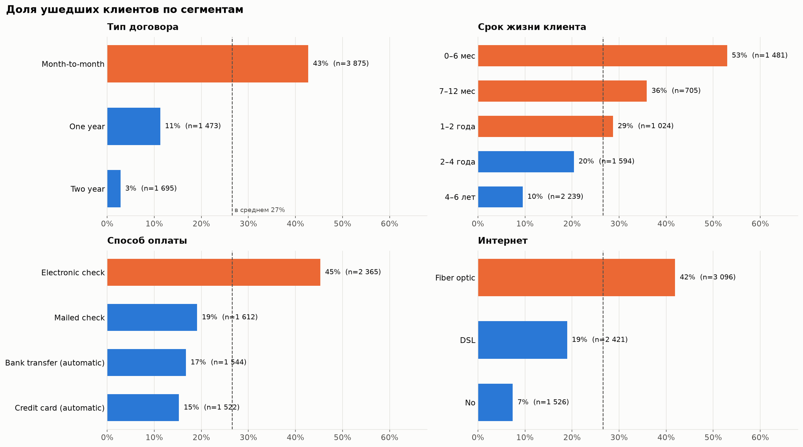
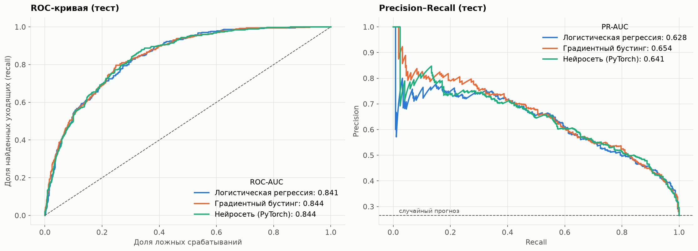
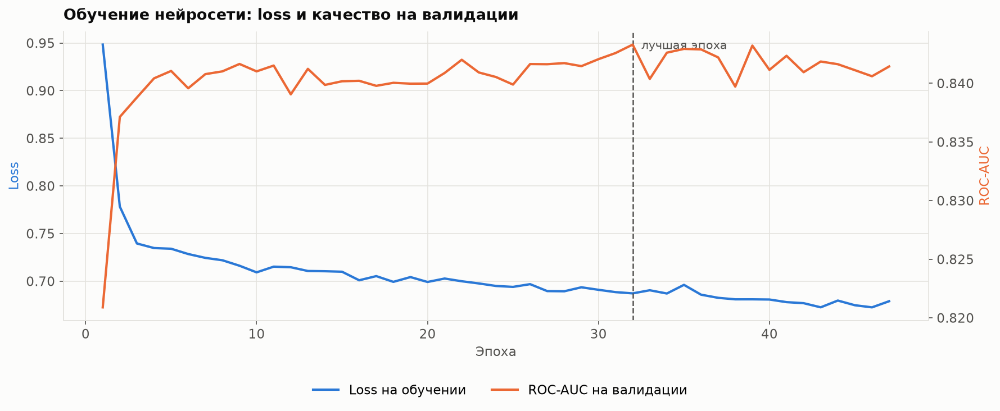
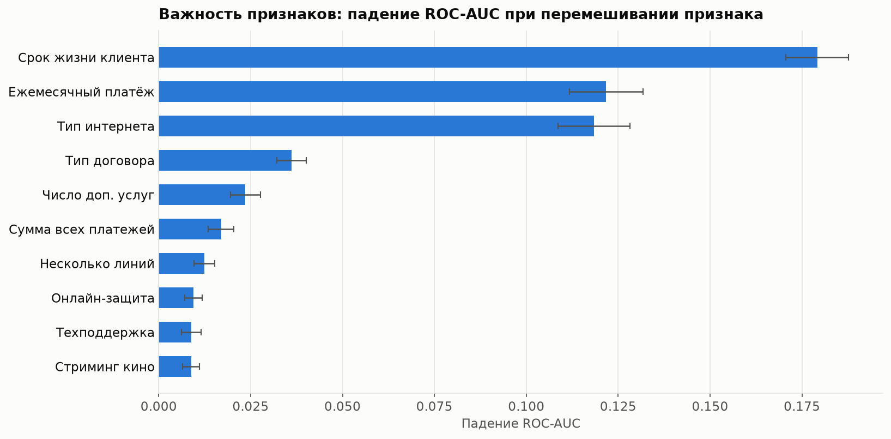
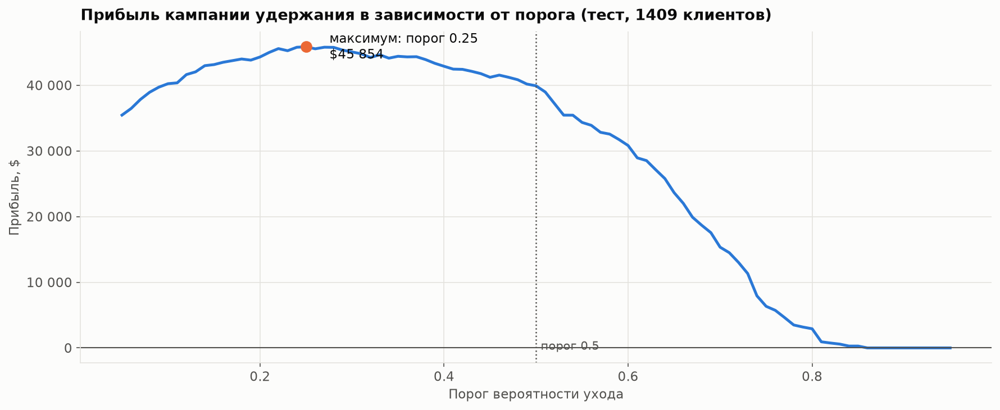

# Отток клиентов телеком-оператора: анализ и прогноз


Каждый четвёртый клиент оператора ушёл. Проект отвечает на три вопроса: **кто и почему уходит**,
**можно ли предсказать уход заранее** и **кому предлагать удерживающую скидку**, чтобы кампания окупилась.

Аналитика + машинное обучение: исследовательский анализ, три модели (логистическая регрессия, градиентный бустинг,
нейросеть на PyTorch), интерпретация и подбор порога по прибыли.

**[→ Открыть ноутбук с полным исследованием](notebooks/churn_analysis.ipynb)**

## Главное

| | |
|---|---|
| **26,5% / 31%** | доля ушедших клиентов / их доля в ежемесячной выручке |
| **43% vs 3%** | отток на помесячном договоре против двухлетнего |
| **ROC-AUC ≈ 0,84** | у всех трёх моделей: сложная модель не даёт выигрыша на этих данных |
| **+15%** | прибыли кампании удержания, если порог выбран по прибыли, а не стандартный 0,5 |

## Портрет уходящего клиента



- **Помесячный договор** — отток 43%, на годовом — 11%, на двухлетнем — 3%.
- **Новички:** больше половины уходят в первые полгода; среди клиентов со стажем 4–6 лет — 10%.
- **Оптоволокно:** отток 42%, вдвое выше, чем у DSL, хотя это более дорогая услуга. Признак проблемы с ценой или качеством.
- **Электронный чек:** отток 45% против 15–19% у других способов оплаты; автоплатёж удерживает.
- **Доп. услуги** (техподдержка, защита, бэкап) снижают отток: с 46% при одной услуге до 5% при всех шести.

## Модели

| Модель | Что это | Подбор параметров |
|---|---|---|
| Логистическая регрессия | базовая линейная модель | GridSearchCV по силе регуляризации |
| Градиентный бустинг | `HistGradientBoostingClassifier` (идея LightGBM) | GridSearchCV по глубине, скорости обучения, числу деревьев |
| Нейросеть (PyTorch) | MLP 64→32, ReLU, Dropout, BCEWithLogitsLoss с весом класса | ранняя остановка по ROC-AUC на валидации |

- Предобработка (стандартизация + one-hot) встроена в `Pipeline` — без утечки данных при кросс-валидации.
- Тестовая выборка (20%) используется один раз, в конце.
- Метрики — ROC-AUC и PR-AUC: классы несбалансированы, accuracy здесь вводит в заблуждение.

| Модель | ROC-AUC (CV) | ROC-AUC (тест) | PR-AUC (тест) |
|---|---|---|---|
| Логистическая регрессия | 0,846 | 0,841 | 0,628 |
| Градиентный бустинг | 0,849 | 0,844 | 0,654 |
| Нейросеть (PyTorch) | — | 0,844 | 0,641 |



Нейросеть обучалась 47 эпох, ранняя остановка вернула веса 32-й эпохи (ROC-AUC на валидации 0,843):



Все модели дают ROC-AUC около 0,84 — разница в пределах разброса кросс-валидации. Для табличных данных
на 7 тыс. строк это ожидаемо: основные зависимости простые, и линейная модель ловит их не хуже нейросети.
Выбрана **логистическая регрессия** — при равном качестве она проще и объяснима для бизнеса.

## Что влияет на прогноз



Перестановочная важность: срок жизни клиента, ежемесячный платёж и тип интернета. Модель опирается
на те же понятные факторы, что видны в анализе.

## Кому предлагать удержание

Порог 0,5 ничем не обоснован. Прибыль кампании считается при допущениях: скидка стоит $60, удерживает 30% уходящих,
удержанный клиент приносит ещё 12 месяцев платежей. Скидку получают и те, кто не ушёл бы, — это расходы.



| Стратегия | Прибыль на 1 409 клиентов теста |
|---|---|
| Скидка всем | ~$13 тыс. |
| Порог 0,5 | ~$40 тыс. |
| **Порог по прибыли (0,25)** | **~$46 тыс.** |

В ноутбуке есть анализ чувствительности: оптимальный порог меняется от 0,05 до 0,6 в зависимости от цены
и эффективности скидки. Порог — бизнес-решение, его пересчитывают по реальным цифрам.

## Рекомендации

1. **Переводить на длинные договоры** — главный рычаг: отток на годовом договоре в 4 раза ниже, на двухлетнем — в 15 раз.
2. **Работать с новичками** в первые полгода: онбординг, проверка качества связи.
3. **Разобраться с оптоволокном:** высокий отток при дорогой услуге.
4. **Переводить на автоплатёж** клиентов с электронным чеком.
5. **Запускать кампанию удержания по модели** с порогом, подобранным по прибыли, и измерить эффект скидки в A/B-тесте.

## Структура

```
telco-churn-prediction/
├── notebooks/
│   └── churn_analysis.ipynb   # анализ, модели, бизнес-выводы
├── src/
│   └── churn.py               # подготовка данных, предобработка, кривая прибыли
├── data/raw/                  # telco_churn.csv
├── reports/figures/           # графики
└── requirements.txt
```

## Запуск

```bash
git clone https://github.com/EfimovAN18/telco-churn-prediction.git
cd telco-churn-prediction
pip install -r requirements.txt
pip install torch --index-url https://download.pytorch.org/whl/cpu   # PyTorch для CPU
jupyter notebook notebooks/churn_analysis.ipynb
```

Без PyTorch ноутбук тоже запустится — раздел с нейросетью будет пропущен.

## Данные

[Telco Customer Churn](https://www.kaggle.com/datasets/blastchar/telco-customer-churn) (IBM Sample Data, Kaggle):
7 043 клиента, 21 признак — демография, подключённые услуги, договор, способ оплаты, платежи и факт ухода.

## Стек

Python · pandas · NumPy · scikit-learn · PyTorch · Matplotlib · Jupyter

---

Автор: **Алексей Ефимов** — [github.com/EfimovAN18](https://github.com/EfimovAN18)
